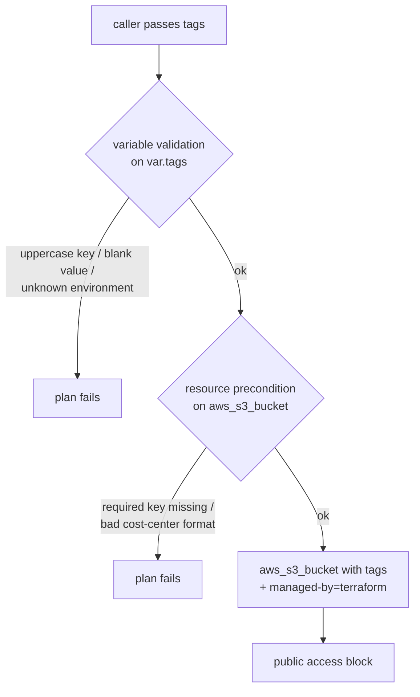

# Terraform module that rejects missing cost-allocation tags

A small Terraform module (an S3 bucket) that will not plan unless its
cost-allocation tags are complete and well formed. It uses only native
Terraform: variable validation and resource preconditions, tested with
`terraform test` and a mocked AWS provider.

> **Status:** the tag rules are covered by 14 `terraform test` runs (2
> passing plans, 12 expected failures, including empty and blank values,
> value case, and uppercase keys) against `mock_provider "aws"`.
> `fmt`, `validate`, and the example root's `init`/`validate` run in CI.
> Nothing has been planned or applied against a real AWS account.
> **Scope:** enforcement applies only to resources created through this
> module. Org-wide enforcement is not implemented (see below).

## Problem

> Build a Terraform module + policy that enforces mandatory cost-allocation
> tags and rejects resources missing them.

Why it matters: untagged resources can't be charged back to a team, so cost
reports end up with a large "unknown" line. Refusing to plan without the
tags fixes this where resources are created, instead of chasing owners
later.

## How the checks are layered



| Rule | Where | Why there |
|---|---|---|
| Tag keys are lowercase (`^[a-z][a-z0-9-]*$`) | `var.tags` validation | `Owner` and `owner` would be two different cost allocation tags |
| Tag values are not blank | `var.tags` validation | an empty tag allocates cost to nobody |
| `environment`, if set, is `dev`, `test`, `staging` or `prod` (case-sensitive, so `Prod` fails) | `var.tags` validation | keeps the cost report's groups clean |
| Every key in `required_tags` is present | `aws_s3_bucket` precondition | compares two inputs, so it sits next to the resource |
| `cost-center` looks like `CC-1234` | `aws_s3_bucket` precondition | example format rule |
| `required_tags` is non-empty and lowercase | `var.required_tags` validation | stops a caller switching the check off with `[]` |

Default `required_tags`: `cost-center`, `owner`, `environment`, `project`.
A caller can change the list, but not empty it.

## Usage

```hcl
module "reports_bucket" {
  source = "github.com/zeinhaidara/33-terraform-mandatory-tag-policy"

  bucket_name = "reports-example-com"
  tags = {
    cost-center = "CC-1234"
    owner       = "platform@example.com"
    environment = "dev"
    project     = "billing-reports"
  }
}
```

Leaving out `owner` fails at plan time with:

```
Error: Resource precondition failed
Missing mandatory tags: owner.
```

### Run the checks locally (same as CI)

```bash
terraform fmt -check -recursive
terraform init -backend=false
terraform validate
terraform test

cd examples/basic
terraform init -backend=false -lockfile=readonly
terraform validate
```

## Versions

- Terraform `>= 1.9.0, < 2.0.0` (CI uses 1.15.8, downloaded and checked
  against a pinned sha256).
- `hashicorp/aws` `>= 6.0, < 7.0` in the module; the example root pins
  `6.73.0`.
- `.terraform.lock.hcl` is committed only in `examples/basic`. A reusable
  module should not ship a lock file; the root that uses it owns provider
  selection.

## What this does not cover

This module only protects resources created **through this module**. Any
`aws_*` resource written directly, created in the console, or made by
another tool is not checked. For organisation-wide enforcement you need
one of:

- **AWS Organizations tag policies** to standardise keys and allowed values
  (they report non-compliance and can block some tagging operations, but do
  not by themselves stop untagged resources from being created);
- **Service control policies** that deny create actions when
  `aws:RequestTag/<key>` is missing, per service and action;
- **Policy as code on the plan**, such as OPA/Conftest or Sentinel, run
  against `terraform show -json` output in CI so every resource in every
  root is checked.

Other limits:

- Only S3 is wrapped. The same `variable` + `precondition` pattern copies
  to any resource type.
- Provider `default_tags` are not inspected; the checks run on the tags
  passed to this module.
- The allowed environments and `CC-1234` format are example rules; change
  them to match your billing setup.

## Security notes

- No credentials, no backend, no state in the repo.
- The bucket gets a public access block with all four settings on.
- Example values (`reports-example-com`, `platform@example.com`) are
  placeholders.

## Idempotency

The module is plain declarative Terraform; re-applying with the same inputs
is a no-op. The checks run on every plan, so a later change that removes a
tag fails before anything is changed.
